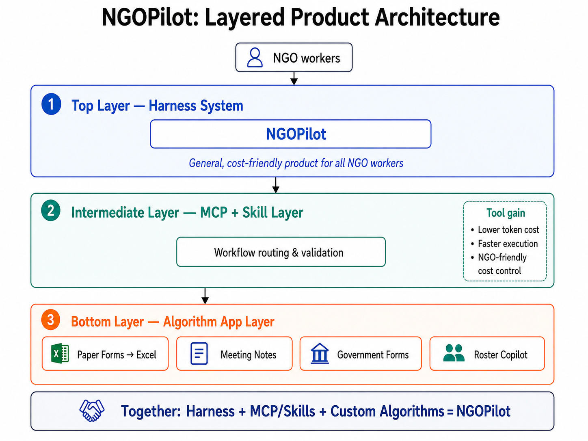

# NGOPilot

**Wilson 原有 Agent Chatbot，已接入四個 NGO 工作流程及可選的活動 Scheduler（2026-10-03）。** 用自然語言和附件交代工作，Agent 選擇工具；在對話中的任務卡核對後，取得真實文件。

目前本機入口：**http://127.0.0.1:8310**。原四卡工作台已退出主入口。

| 工具 | 輸入 | 成品 |
| --- | --- | --- |
| 紙本表格 → Excel | 探訪表格圖片 | 已核對 Excel |
| 會議／家訪記錄 | TXT／Markdown／DOCX 轉寫稿 + Word 範本 | Word 記錄 |
| 政府表格填報 | 支援表格及長者資料 | PDF |
| 人手排班 | HC 家居照顧時間表 + 護送總表 + 目標週 | 排班草稿 Excel |
| 活動小冊子 → 日曆 | PDF + 年份 | ICS、CSV，同批活動月曆 |

- [啟動、使用與備份](docs/agent-chatbot/HANDOVER.md)
- [機構帳號（參考 Atlas）](docs/agent-chatbot/ACCOUNTS.md)
- [Opus 5.5 的產品決定](docs/agent-chatbot/opus-product-decision.md)
- [Foundry Luna 設定與最新驗收](docs/agent-chatbot/LUNA-ATLAS.md)
- [先前驗收證據（舊模型）](docs/agent-chatbot/ACCEPTANCE.md)

Scheduler 保留旁邊的 `Careflow Scheduler` repo 及 8311 月曆介面，作為第五個獨立工具接入。Atlas 維持既有地區探訪原型，本輪沒有改動。

`docs/takeover/` 記錄 10 月 2 日的歷史工作台方案；產品入口與本輪驗收請以上述 Agent 文件為準。現有驗收使用合成資料，沒有把它當成 NGO 採用或雲端部署。

## Repository Layout

- `harness bone/`: NGOPilot agent runtime, CLI, and desktop application
- `MCPcode/`: NGOPilot MCP server and four original stateful NGO tools and an optional Scheduler tool
- `algo-dependencies/CareFlow/`: CareFlow algorithm dependency source
- `algo-dependencies/RosterCopiilot/`: roster algorithm dependency source

The original NGOPilot Agent uses the MCP server as a first-party stdio extension.
MCP owns workflow validation, durable jobs, review state, and delivered artifacts.
The authenticated conversation task card records exact human confirmations; the Agent cannot grant them through MCP.

See [Agent-MCP Architecture Design Plan.md](Agent-MCP%20Architecture%20Design%20Plan.md)
for the product architecture and
[MCP-pre-build algorithm design plan.md](MCP-pre-build%20algorithm%20design%20plan.md)
for the MCP and algorithm boundaries.
